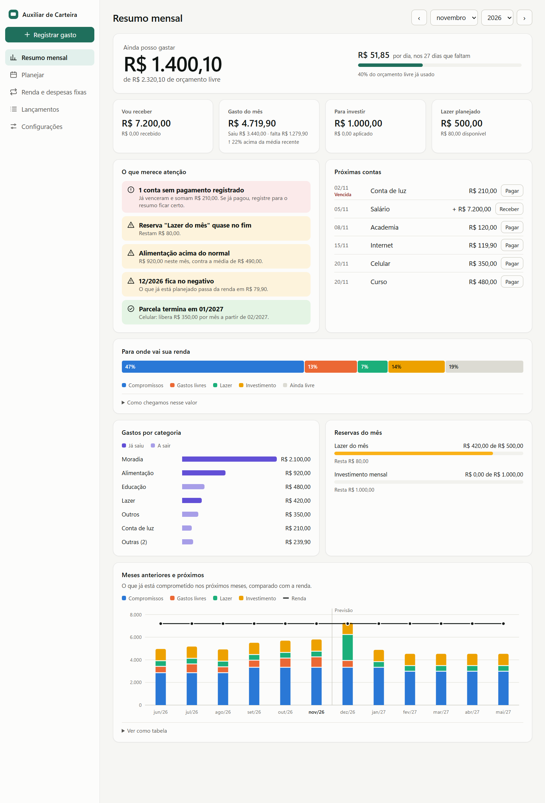
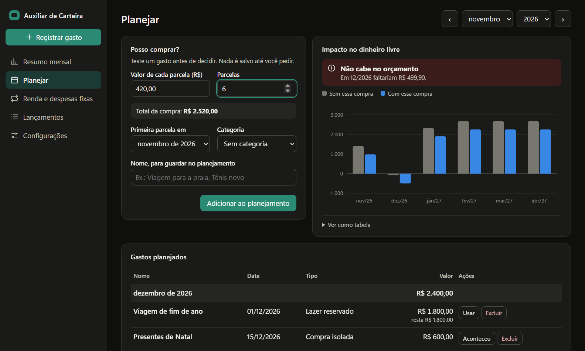

# Auxiliar de Carteira

Aplicativo desktop para organizar o orçamento mensal pessoal. Funciona offline, no Windows, sem cadastro nem servidor. Seus dados ficam só no seu computador.

Ele responde: quanto vou receber, quanto está comprometido, quanto vai para investimentos, quanto reservei para lazer e quanto ainda posso gastar.



## Destaques da versão 0.3

- **Painel do mês:** quanto ainda posso gastar, valor por dia e gasto comparado à média recente.
- **Simulador "Posso comprar?":** veja o impacto de uma compra ou parcelamento nos próximos meses antes de decidir.
- **Alertas automáticos:** contas vencidas, ritmo de gasto, categoria fora do normal, mês futuro negativo e parcela prestes a acabar.
- **Gráficos úteis:** para onde vai a renda, gastos por categoria e o que já está comprometido nos próximos meses.
- **Modo escuro.**



As imagens usam dados fictícios. O que mudou em cada versão está no [histórico de versões](CHANGELOG.md).

## Instalar e usar

1. Baixe o instalador `.exe` mais recente na aba **Releases** deste repositório.
2. Dê dois cliques no arquivo e siga os passos.
3. Abra pelo atalho **Auxiliar de Carteira** na área de trabalho ou no menu Iniciar.
4. Comece em **Renda e despesas fixas**: cadastre o salário e as contas uma vez, e eles aparecem todos os meses.

Para atualizar, feche o aplicativo e rode o instalador da versão nova. Os dados são mantidos.

O instalador não tem assinatura digital, que é um certificado pago. Por isso o Windows pode mostrar "O Windows protegeu o computador". Clique em **Mais informações** e depois em **Executar assim mesmo**.

## O que cada área faz

- **Resumo mensal:** quanto ainda posso gastar, quanto por dia, para onde vai a renda, gastos por categoria, alertas, próximas contas e a visão dos meses seguintes.
- **Planejar:** simulador "Posso comprar?", que mostra o impacto de um gasto ou parcelamento antes de salvar, e a lista de lazer e compras planejadas.
- **Renda e despesas fixas:** salário e contas que se repetem todo mês.
- **Lançamentos:** lista completa do mês, com filtros.
- **Registrar gasto:** botão sempre visível para anotar um gasto na hora.

Os alertas seguem regras fixas e aparecem só quando há algo a dizer. Uma categoria só é apontada como "acima do normal" com ao menos dois meses de histórico dela, e quando passa da média em 20% e R$ 50,00. O ritmo de gastos livres só é projetado a partir do dia 5. No simulador, "apertado" significa sobrar menos de 10% da renda no pior mês.

## Requisitos para desenvolver

- Windows 10 ou 11, 64 bits
- Node.js 22.12 ou mais novo (testado com o 24.22.1)

Python e Visual Studio **não** são necessários: o driver SQLite já vem com binários prontos.

## Comandos

Execute na pasta do projeto, em um terminal:

| Comando | O que faz |
| --- | --- |
| `npm install` | Baixa as dependências e o Electron. Rode uma vez. |
| `npm run dev` | Abre o aplicativo em modo de desenvolvimento. |
| `npm test` | Roda os testes das regras e do banco. |
| `npm run test:e2e` | Abre o aplicativo real e testa os fluxos principais. |
| `npm run typecheck` | Confere os tipos do TypeScript. |
| `npm run dist` | Roda as verificações e gera o instalador em `dist\`. |

Para rodar os testes de ponta a ponta no aplicativo já empacotado, aponte para o executável:

```powershell
$env:AUX_CARTEIRA_EXE = "$PWD\dist\win-unpacked\Auxiliar de Carteira.exe"
npx vitest run --config vitest.e2e.config.mts
Remove-Item Env:AUX_CARTEIRA_EXE
```

### Se o Electron não abrir pelo terminal

Se aparecer erro de `app` indefinido ou o Electron se comportar como Node, a variável `ELECTRON_RUN_AS_NODE` está ligada no terminal. Rode isto e tente de novo:

```powershell
Remove-Item Env:ELECTRON_RUN_AS_NODE
```

## Onde ficam os dados

```text
%APPDATA%\Auxiliar de Carteira\carteira.sqlite
```

Normalmente é `C:\Users\<seu usuário>\AppData\Roaming\Auxiliar de Carteira\`. O caminho exato aparece em **Configurações**.

- Esta pasta fica fora da instalação. Atualizar, reinstalar ou desinstalar o aplicativo não apaga os dados.
- Para apagar tudo de vez, desinstale e exclua essa pasta manualmente.
- Antes de cada restauração, uma cópia dos dados atuais vai para `copias-de-seguranca\`, na mesma pasta.

## Backup

Em **Configurações**, use **Exportar backup** para salvar uma cópia em outro lugar, como um pendrive ou uma pasta na nuvem. O backup fica só no local que você escolher: o aplicativo não faz cópias externas sozinho.

**Restaurar backup** confere o arquivo, pede confirmação e substitui todos os dados atuais.

## Como as contas funcionam

```text
Orçamento livre = renda − compromissos − investimento reservado − lazer reservado
Ainda posso gastar = orçamento livre − gastos livres − uso acima das reservas − aportes sem reserva
```

- Quando há valor realizado, ele substitui o previsto. Os dois nunca são somados.
- Lazer e investimento são reservas. Para usá-las, clique em **Usar** na reserva e registre o gasto ou aporte. O valor dentro da reserva não é descontado de novo; só o que passar dela reduz o restante.
- Uma sobra de reserva continua reservada no mês. Para liberá-la, reduza o valor da reserva.
- "Fatura" apenas agrupa itens. O subtotal é informativo e não entra nas contas.
- A categoria "Cartão de crédito" serve para custos do próprio cartão, como anuidade. Não cadastre nela o total de uma fatura cujas compras também estejam registradas, ou o valor contará duas vezes.
- Isto é planejamento, não saldo bancário.

## Estrutura do código

```text
src/shared/     Regras financeiras, análises, datas, dinheiro e validação (sem banco nem interface)
src/main/       Janela, IPC, banco, migrações e backup
src/preload/    API restrita entre a interface e o processo principal
src/renderer/   Interface React
tests/          Testes de regras e banco; tests/e2e/ testa o aplicativo real
docs/           Roadmap e decisões técnicas
```

Para mudar a estrutura do banco, acrescente uma migração ao final da lista em `src/main/db/migracoes.ts`. Nunca altere uma migração já publicada.
